# Diseño UX/UI · 2026

Monorepo con los trabajos prácticos de Diseño UX/UI de la Licenciatura en Sistemas de Información. Cada trabajo vive en su propia carpeta y se corre por separado.

| Trabajo | Qué es | Stack | Código |
| --- | --- | --- | --- |
| TP3 | Ejercicios de maquetado (`EJ1` a `EJ20`) | HTML y CSS | [TP3](TP3) |
| TP4 | Landing page de la cafetería Coffea | HTML y CSS | [TP4](TP4) · [README](TP4/README.md) |
| TP5 | Contratación digital de seguros (Cubrí Seguros) | HTML, Tailwind CSS v4, Basecoat UI y JavaScript | [TP5/cubri-seguros](TP5/cubri-seguros) · [README](TP5/cubri-seguros/README.md) |

## TP5 · Cubrí Seguros

Checkout de un seguro de celular: el usuario elige un producto, cotiza, elige un plan, carga sus datos, paga (simulado) y recibe su número de póliza.

**Sitio publicado:** https://cubriseguros1.netlify.app/

Las decisiones tomadas, los bonus y las tarjetas de prueba están en el [README del TP5](TP5/cubri-seguros/README.md).

### Mobile (390 px)

| Inicio | Cotizar | Elegir plan | Datos |
| --- | --- | --- | --- |
| 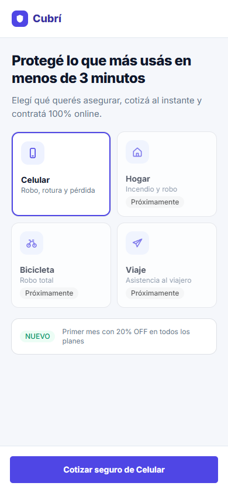 | 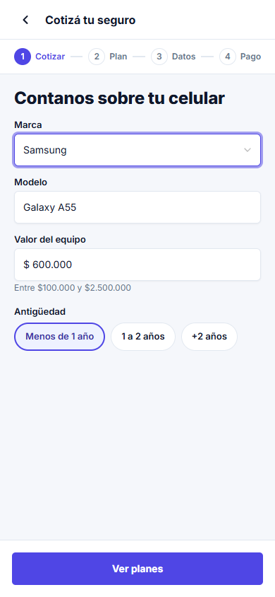 | 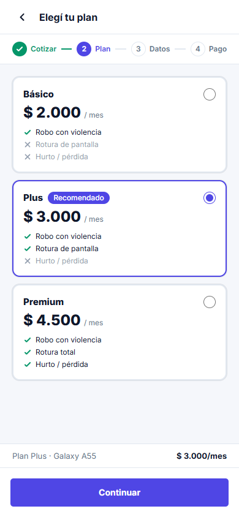 | 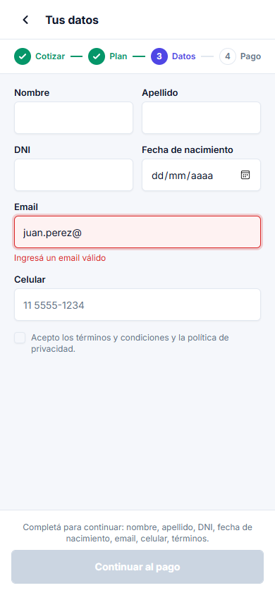 |

| Pago | Éxito | Error |
| --- | --- | --- |
| 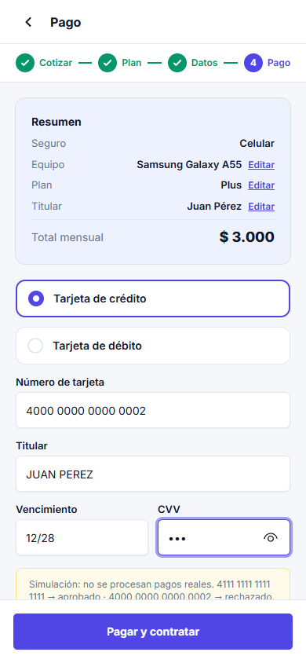 | 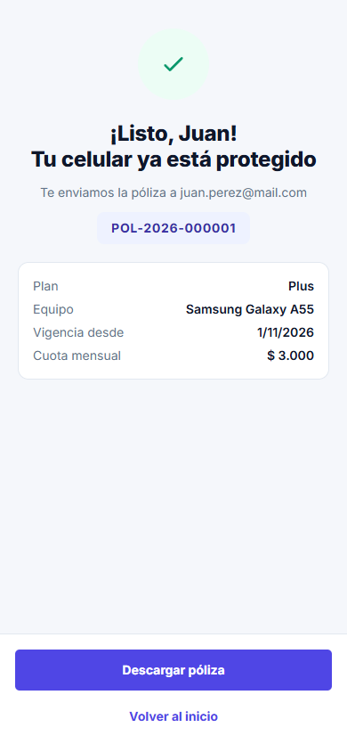 | 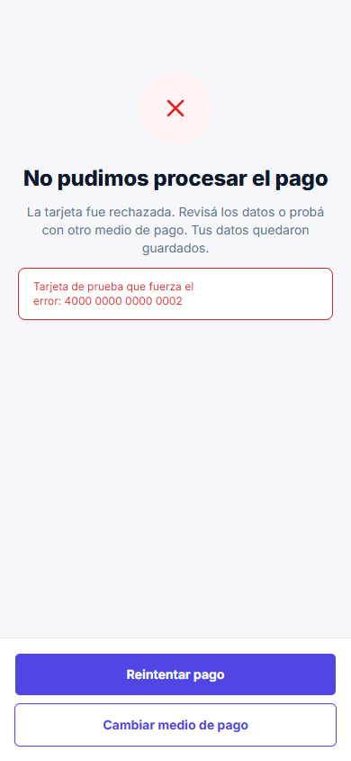 |

### Desktop (1440 px)

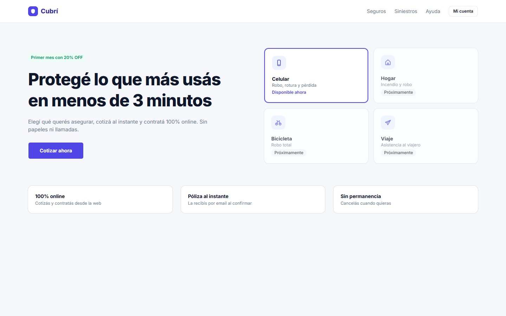
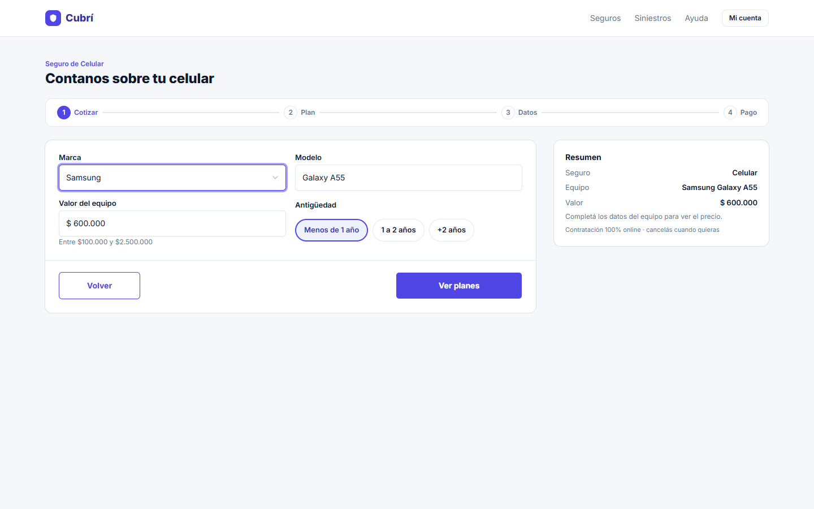
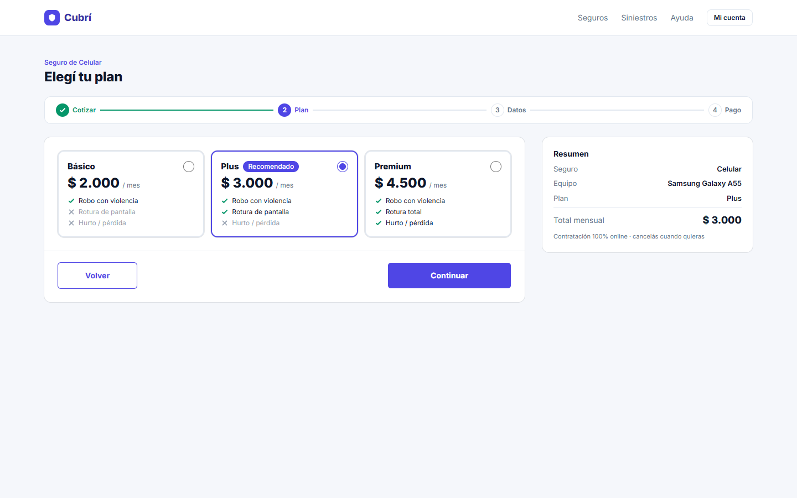
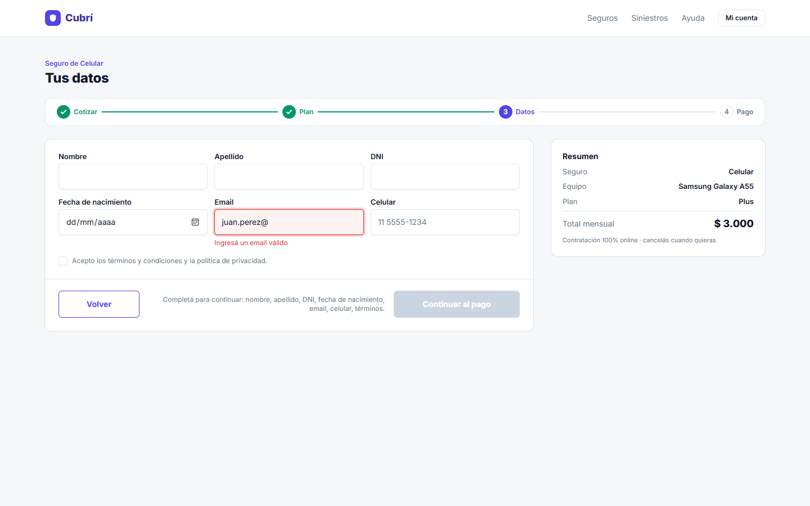
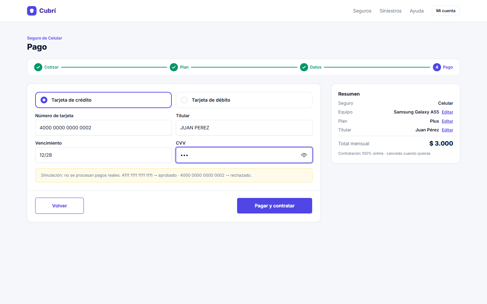
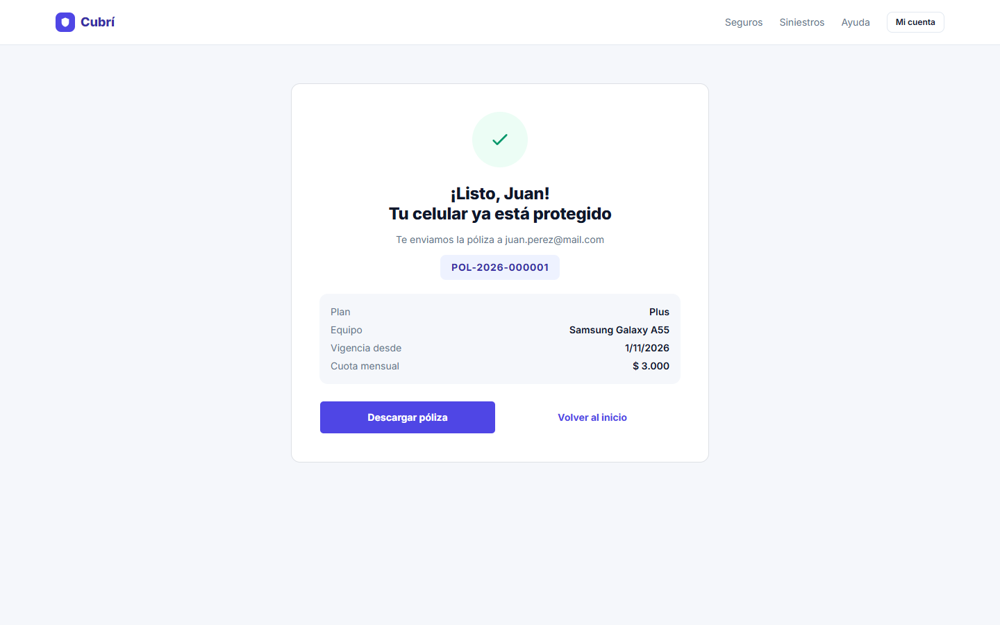
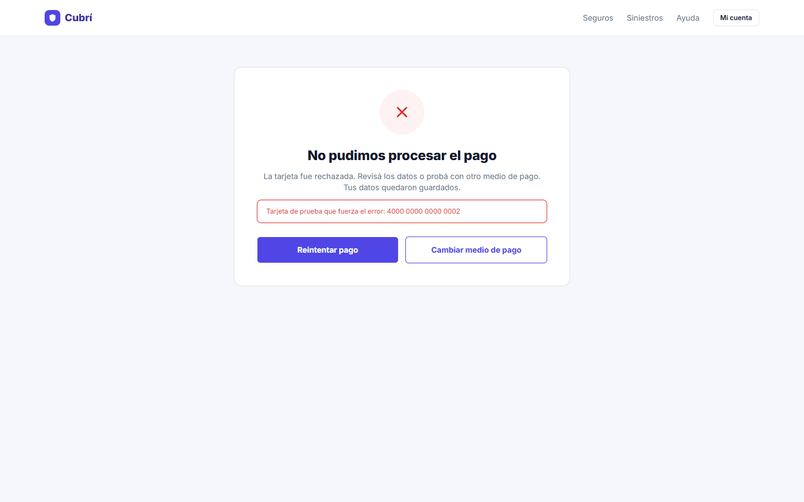

## Publicación

- **TP4:** se publica en Netlify desde este repo, con el `netlify.toml` de la raíz.
- **TP5:** se publica en un sitio de Netlify aparte, subiendo la carpeta `TP5/cubri-seguros`.
