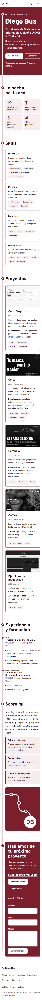
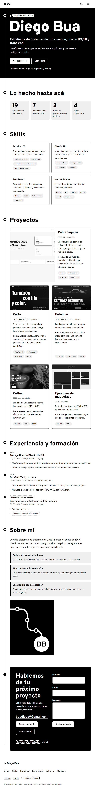
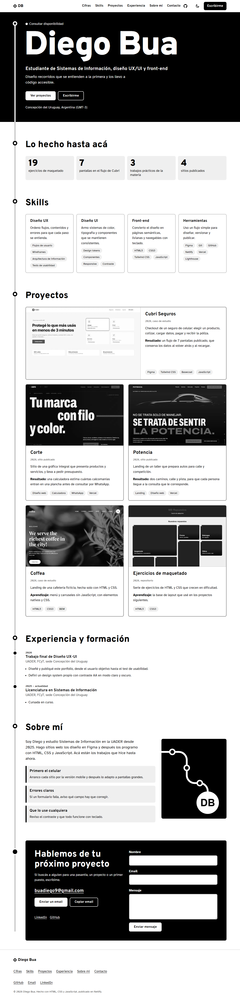
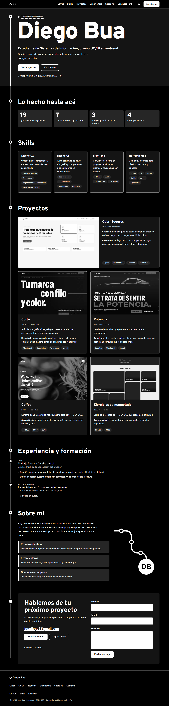
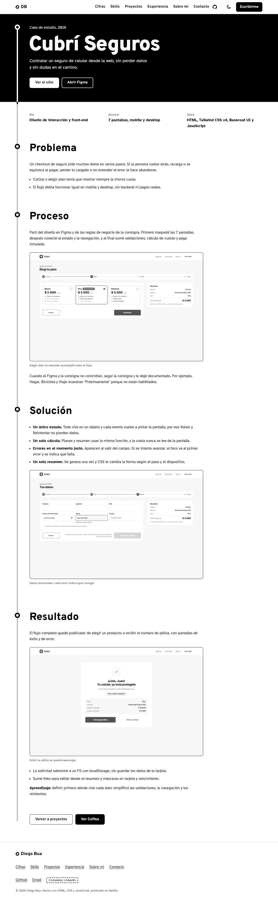

# Portfolio de Diego Bua (Trabajo Final)

Portfolio web personal para Diseño UX-UI 2026, Licenciatura en Sistemas de Información. Es un one-page con las 9 secciones de la consigna y dos casos de estudio internos.

| | |
| --- | --- |
| Sitio | https://portfoliobua.netlify.app/ |
| Figma | [Archivo de Figma](https://www.figma.com/design/fRxsWvBy9efbPUUrs7d37K/Portfolio-Diego-Bua?node-id=0-1) |
| Repositorio | https://github.com/buadiego1/Dise-o-UX-UI |
| Stack | HTML5, CSS3 con variables y JavaScript vanilla |
| Entregables | [PDF del proceso](../entrega/proceso-portfolio-diego-bua.pdf) · [Captura de Lighthouse mobile](../entrega/lighthouse-mobile.png) |

## Antes de entregar

El sitio marca con un recuadro punteado lo que falta completar. Para encontrar todo:

```bash
grep -rn "Completar:" --include=*.html .
```

- [ ] Stack y rol en las tarjetas de Corte y Potencia, si querés sumarlos.
- [ ] Reemplazar la ilustración por una foto si preferís una foto real.

## Cómo correrlo

Desde esta carpeta:

```bash
npx serve
```

No requiere compilación.

## Estructura

```text
portfolio/
├── index.html            one-page
├── casos/                casos de estudio
├── 404.html, gracias.html
├── css/tokens.css        paleta, tipografía y espaciado
├── css/styles.css        base, componentes y secciones
├── js/theme.js           tema antes de pintar
├── js/main.js            menú, tema, sección actual, línea y copiar email
├── assets/               fuentes e imágenes
├── _headers              headers de seguridad y caché
└── docs/                 proceso, wireframes, design system y capturas
```

## Proceso UX/UI

1. [Usuario objetivo y benchmark](docs/proceso/01-usuario-y-benchmark.md)
2. [Concepto y arquitectura de información](docs/proceso/02-concepto-y-arquitectura.md)
3. [Wireframes](docs/wireframes/wireframes.png), con su [fuente](docs/wireframes/index.html)
4. [Design system](docs/design-system.png), con su [fuente](docs/design-system.html)
5. [Test de usabilidad](docs/proceso/03-test-de-usabilidad.md) con Luca, Valentín y Luciano, con hallazgos y cambios aplicados. [Versión web](https://portfoliobua.netlify.app/docs/test-de-usabilidad.html).
6. [Slides del proceso](docs/proceso/proceso-portfolio.pdf)

## Decisiones

- **El recorrido como concepto.** Una línea une las secciones y avanza con el scroll. Con `prefers-reduced-motion` queda completa y fija.
- **Sin Tailwind.** Las variables CSS alcanzan y evitan un paso de build.
- **Fuentes autoalojadas.** Overpass y Atkinson Hyperlegible, con `font-display: swap`.
- **Orden de secciones.** Se mantiene el de la consigna, porque lleva de la propuesta a la evidencia y al contacto.
- **Menú hamburguesa hasta 1024 px.** Además de 375, 768 y 1280 px, hay un corte en 1024 px porque la navegación completa no entra antes.

## Verificación

Pruebas automáticas en local, más Lighthouse sobre el sitio publicado:

- Lighthouse mobile sobre https://portfoliobua.netlify.app/ el 9 de noviembre de 2026: 99 en Performance y 100 en Accessibility, Best Practices y SEO. [Captura](docs/capturas/lighthouse-mobile.png).
- Sin scroll horizontal ni contraste por debajo de AA en 375, 768 y 1280 px, en claro y oscuro, en las 5 páginas.
- Un solo `h1`, sin saltos de encabezados y todas las imágenes con `alt`.
- Recorrido con teclado en mobile, menú con `aria-expanded` y `aria-controls`, cierre con Escape y anclas sin quedar debajo del header.


## Bonus

- Modo claro y oscuro con `prefers-color-scheme` y botón.
- Formulario de contacto que arma el email con nombre, mensaje y asunto, listo para enviar.
- Segundo caso de estudio, con navegación entre casos.
- Página 404 personalizada.
- Headers de seguridad.
- Animación accesible de la línea.

## Publicación en Vercel

Publicado desde este repositorio, sin subir archivos a mano.

1. En Vercel: *Add New* → *Project* e importar el repo de GitHub.
2. Framework preset: *Other*. Root Directory: `TP-Final/portfolio`. Build command y output: vacíos.
3. Deploy. Cada push a `main` publica de nuevo (CI/CD).

La configuración de Vercel está en el `vercel.json` de la raíz del repo: publica la carpeta `TP-Final/portfolio` y define los headers de seguridad y la caché. El sitio se publicó primero en Netlify (`_headers` y `netlify.toml` quedan como referencia), pero el plan gratis agotó sus créditos y pausó los deploys, así que se pasó a Vercel.

## Créditos

- Sin templates: el diseño y el código son propios de este trabajo.
- Fuentes: [Overpass](https://fonts.google.com/specimen/Overpass) y [Atkinson Hyperlegible](https://fonts.google.com/specimen/Atkinson+Hyperlegible), licencia OFL, instaladas desde Fontsource.
- Imágenes: capturas de TP3, TP4, TP5 y de los sitios publicados de Corte y Potencia.

## Uso de IA

Se usó Claude Code para redactar la documentación del proceso, proponer el concepto visual, escribir el HTML, CSS y JavaScript, y correr las verificaciones automáticas. El autor debe revisar los textos antes de entregar. Persona y card sorting son hipótesis de trabajo. El test de usabilidad no fue generado por IA y debe hacerse con personas reales.

## Capturas

| Mobile | Tablet |
| --- | --- |
|  |  |




