# Cubrí Seguros · Contratación digital (TP5)

Front-end de un checkout de seguro de celular: el usuario elige un producto, cotiza, elige un plan, carga sus datos, paga (simulado) y recibe su número de póliza. No hay backend ni pagos reales.

**Sitio publicado:** https://buadiego1.github.io/Dise-o-UX-UI/TP5/cubri-seguros/

**Diseño base:** [Figma](https://www.figma.com/design/vJrfOUfiOI7OSeTtRfCloh)

**Stack:** HTML5 · Tailwind CSS v4 · Basecoat UI · JavaScript vanilla (sin frameworks ni librerías de validación).

## Cómo correrlo

No requiere instalación ni compilación, pero sí un servidor local: abrir `index.html` con doble click (`file://`) hace fallar el `fetch` de `data/planes.json`. Desde esta carpeta:

```bash
npx serve
```

También sirve la extensión Live Server de VS Code.

### Datos de prueba

| Tarjeta | Resultado |
| --- | --- |
| 4111 1111 1111 1111 | Aprobado → pantalla de éxito |
| 4000 0000 0000 0002 | Rechazado → pantalla de error |
| Cualquier otro número de 16 dígitos | Aprobado |

Nunca usar datos de tarjetas reales.

## Estructura

```
cubri-seguros/
├── index.html          una sola página: cada paso es una <section data-paso>
├── css/tokens.css      colores del Figma y estilos sobre Basecoat
├── data/planes.json    planes y tasas
├── js/
│   ├── app.js          arranque, eventos y navegación
│   ├── estado.js       objeto solicitud y funciones para modificarlo
│   ├── render.js       pinta cada paso a partir del estado
│   ├── validaciones.js funciones puras: reciben un valor y devuelven error o null
│   ├── cotizador.js    calcularCuota() y formato de moneda
│   └── pago.js         simularPago() y generarPoliza()
├── docs/capturas/      capturas mobile y desktop
└── README.md
```

## Decisiones tomadas

- **Un único estado.** Todo vive en `solicitud`; cada evento lo modifica y después llama a `render()`. Los inputs se rellenan desde el estado, por eso "Volver" y "Reintentar" no pierden datos.
- **Un solo resumen.** `renderResumen()` genera el resumen una vez y CSS le cambia la forma según el paso: card lateral en desktop, barra fija arriba del botón en el paso 2 de mobile y card arriba del formulario en el paso 4.
- **Un solo cálculo.** Planes y resumen usan `calcularCuota()`; la cuota nunca se guarda ni se lee del DOM.
- **Colores propios en `@theme`.** Los `indigo-*` y `slate-*` de Tailwind v4 no coinciden exactamente con los HEX del Figma, así que los tokens se declaran con esos valores (`bg-brand`, `text-mute`, etc.).
- **Errores en el momento justo.** Aparecen al salir del campo. Si se intenta avanzar con Enter o con clic sobre el botón deshabilitado, se revalida todo el paso y el foco va al primer error. Debajo del botón se indica qué falta completar.
- **Vencimiento.** La tarjeta se considera vigente hasta el último día del mes indicado, así que el mes en curso es válido.
- **Celular.** Se rechazan los números que empiezan con 0 o con 15, después de quitar espacios y guiones.

### Diferencias con el Figma

Cuando el Figma y la consigna no coinciden, se siguió la consigna:

- Hogar, Bicicleta y Viaje muestran "Próximamente" en lugar de un precio, porque no están habilitados.
- Celular muestra "Disponible ahora" en lugar de "desde $2.000/mes", porque ese precio no es el mínimo real de la fórmula.
- El paso 4 en mobile incluye el campo Titular, que la consigna exige y solo aparece en el frame desktop.
- "Volver" también aparece en el paso 1 en desktop.
- El aviso de la pantalla de error usa `data-variant="destructive"`, como indica el mapeo de componentes.

El banner "Primer mes con 20% OFF" es parte del diseño y no modifica la cuota: las reglas de negocio no definen ese descuento. "Descargar póliza" baja un archivo de texto con los datos de la póliza simulada.

## Bonus realizados

- **Persistencia:** la solicitud se guarda en `localStorage`, sobrevive a un F5 y se limpia al terminar. Tarjeta, vencimiento y CVV no se guardan: quedan solo en memoria.
- **Editar desde el resumen:** links "Editar" en el paso de pago que llevan al paso correspondiente y vuelven al pago.
- **Máscaras de input:** tarjeta en grupos de 4 y vencimiento con barra automática.

## Capturas

### Mobile (390 px)

| Inicio | Cotizar | Elegir plan | Datos |
| --- | --- | --- | --- |
| 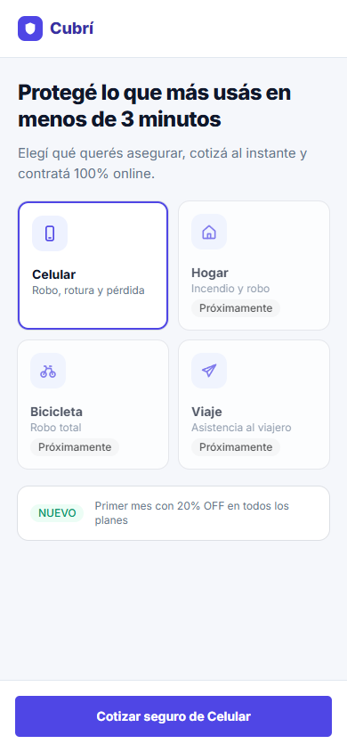 | 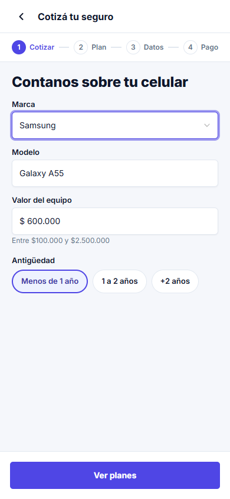 | 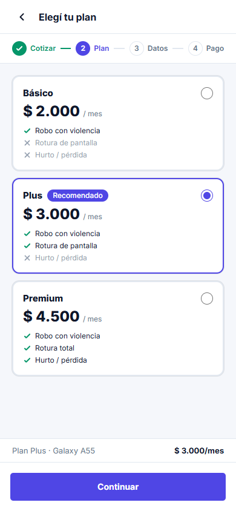 | 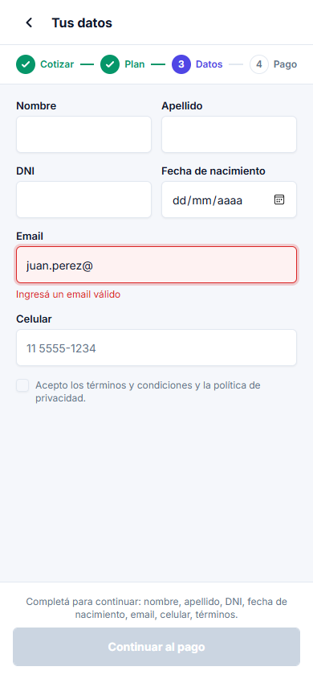 |

| Pago | Éxito | Error |
| --- | --- | --- |
| 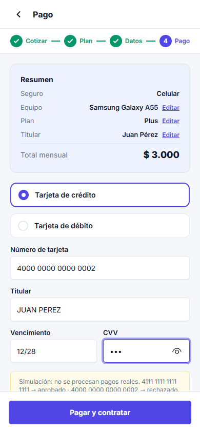 | 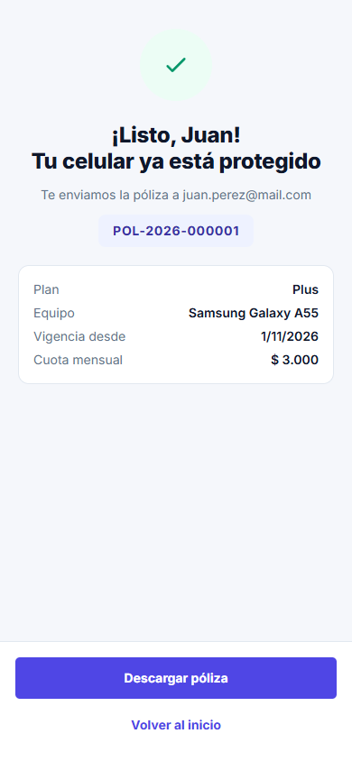 | 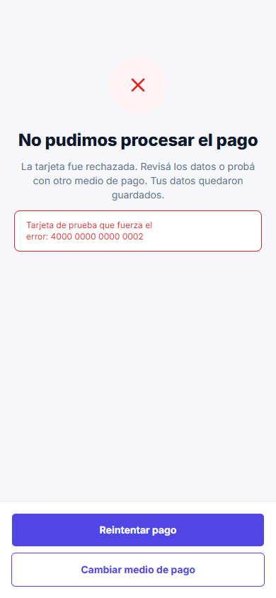 |

### Desktop (1440 px)

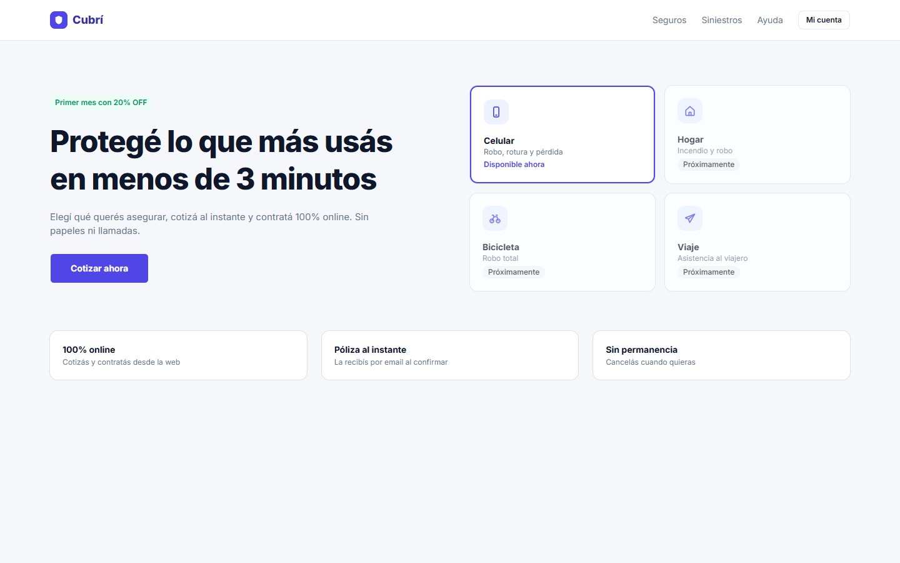
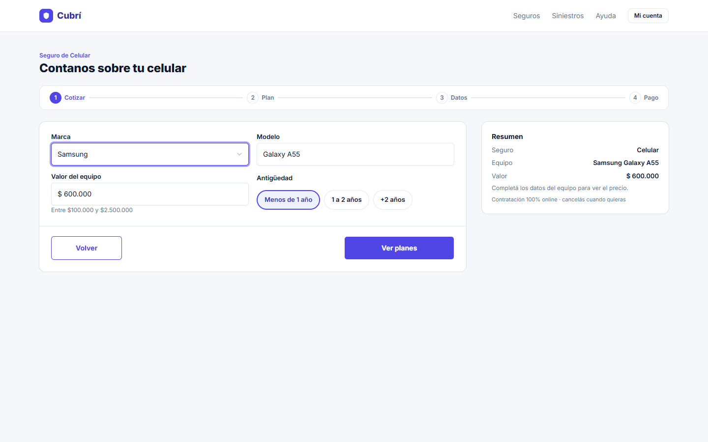
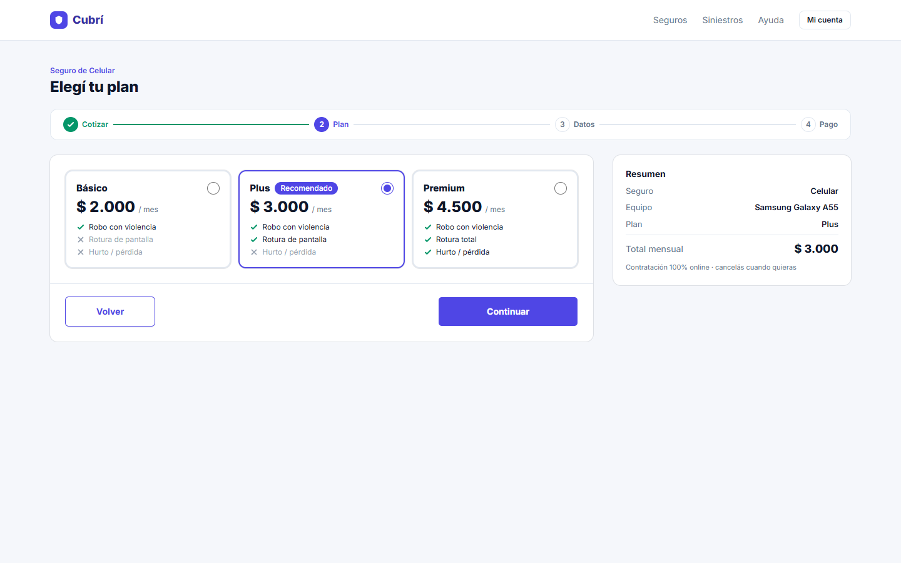
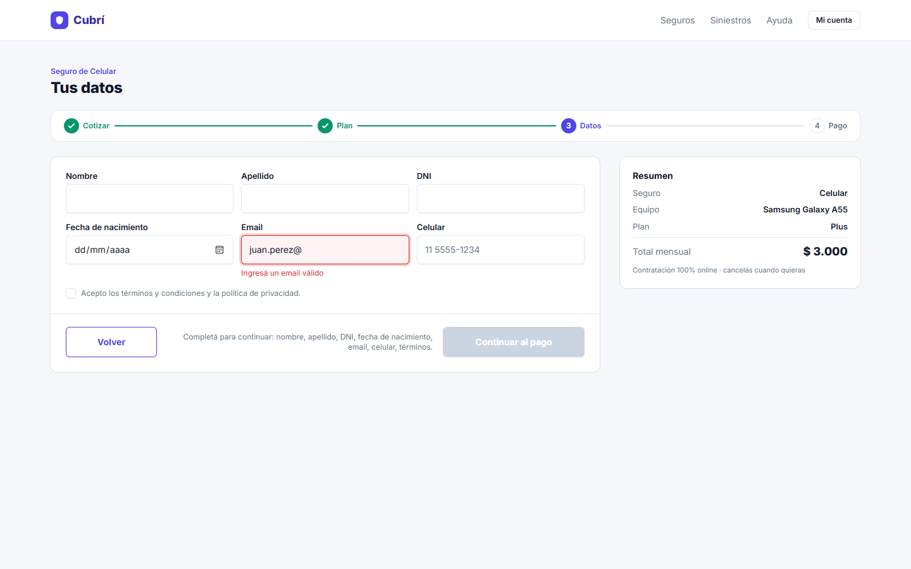
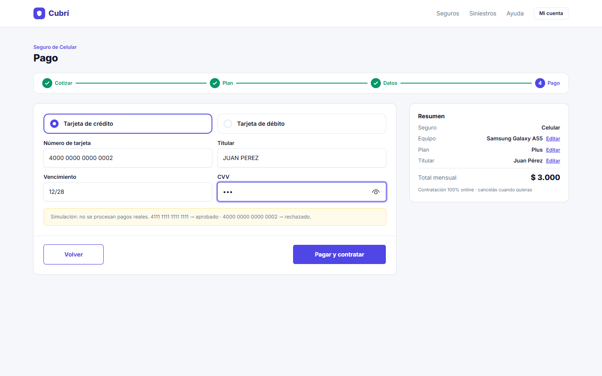
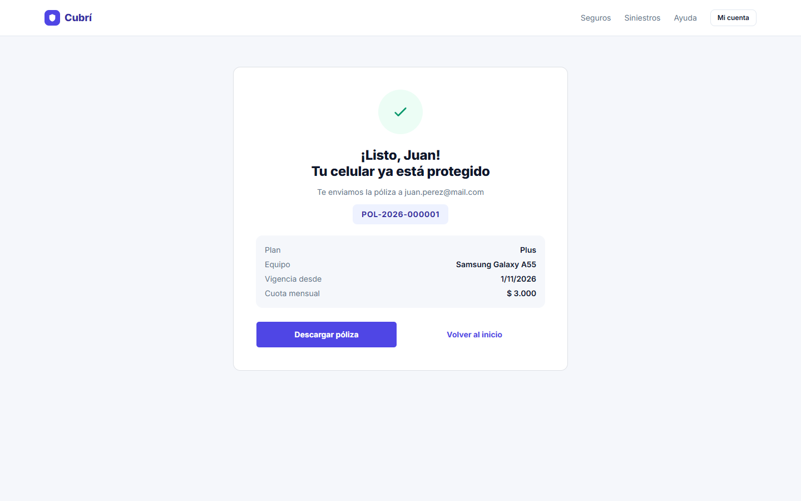
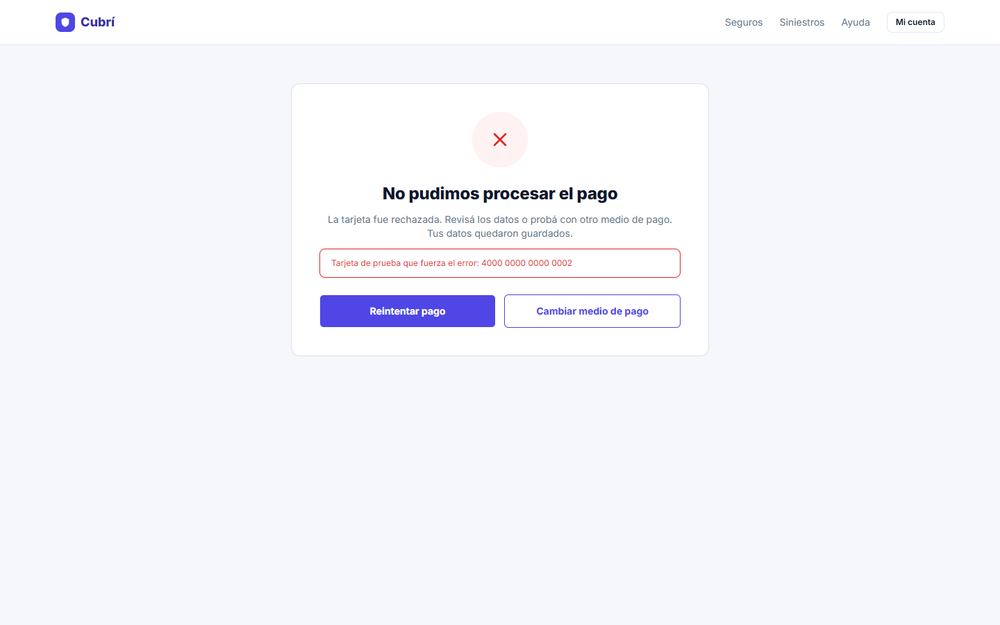
